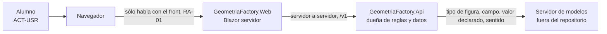
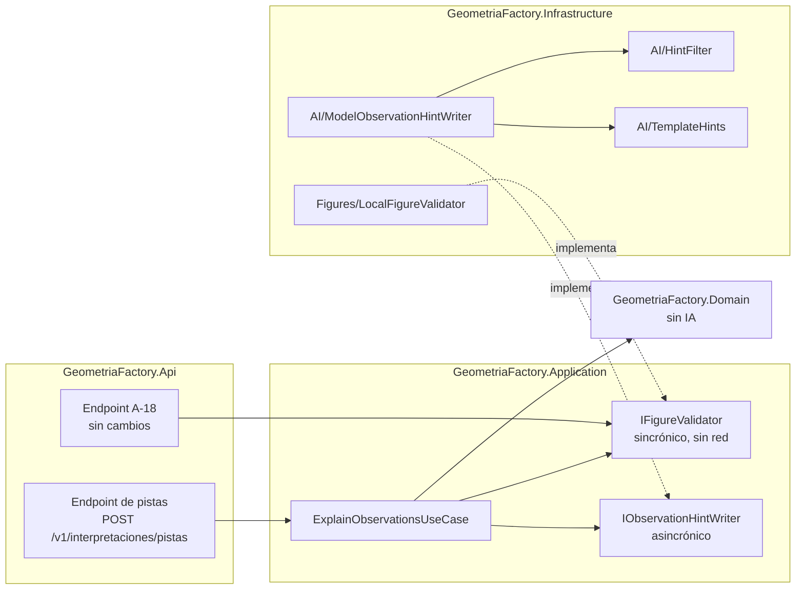

# Capa de IA de la Fábrica de Geometría · V1 · Pistas sobre las observaciones

| Campo | Valor |
|---|---|
| Documento | `ai-layer/01-Especificacion-V1-Pistas.md` |
| Versión | 0.1 (especificación; nada construido) |
| Estado | Propuesta. No modifica el intake ni el código; su ingreso al alcance se eleva al Product Owner (`SDD/Expedientes/0002-Capa-De-IA-Pistas-Y-Borrador/`) |
| Fecha | 2026-11-01 |
| Base | `main` `5f07b12` |
| Método | Conocimiento de especificación de la capa de IA, versión 0.1 (v0), aplicado **sin la guía** de la capa de IA; las remisiones `[Con §x]` son a ese conocimiento |
| Contexto | CTX-EXISTENTE · CTX-PROTO (ver §1.3) |

## Índice

- [1. Introducción y metas (arc42 §1)](#1-introducción-y-metas-arc42-1)
- [2. Contexto y alcance (arc42 §3)](#2-contexto-y-alcance-arc42-3)
- [3. Vista de bloques (arc42 §5)](#3-vista-de-bloques-arc42-5)
- [4. Conceptos transversales (arc42 §8)](#4-conceptos-transversales-arc42-8)
- [5. Ficha de la capacidad y prompt propio](#5-ficha-de-la-capacidad-y-prompt-propio)
- [6. Decisiones (arc42 §9)](#6-decisiones-arc42-9)
- [7. Requisitos de calidad (arc42 §10)](#7-requisitos-de-calidad-arc42-10)
- [8. Riesgos (arc42 §11)](#8-riesgos-arc42-11)
- [9. Lo que esta especificación no decide](#9-lo-que-esta-especificación-no-decide)
- [Glosario](#glosario)

## 1. Introducción y metas (arc42 §1)

### 1.1 Qué hace hoy el producto

El alumno pega el texto JSON que emite su propio programa (el método `Describir()` de la Actividad 1). El
validador determinista lo interpreta, reconstruye las figuras y **señala la discrepancia entre el valor
declarado y el derivado de las dimensiones**, sin corregirla (trampa T4 de
`SDD/Docs/Unidades-Entrega/GeometriaFactory-Api/02-Especificacion-Funcional/Definicion-Contrato-Del-Validador-De-Figuras.md` §2).
Cada discrepancia es una `Observation` de tipo `Warning` con pieza, campo (`Area` o `Volumen`), valor
declarado y valor derivado (`src/GeometriaFactory.Domain/Entities/Observation.cs`,
`src/GeometriaFactory.Infrastructure/Figures/LocalFigureValidator.cs`, función `Verify`).

**Capacidad V1.** Ante cada observación de tipo `Warning`, el producto ofrece al alumno **tres pistas
graduadas** para que encuentre por su cuenta el error de su programa, **sin darle el valor correcto ni el
texto corregido**.

### 1.2 Las cuatro preguntas [Con §1]

| # | Pregunta | Respuesta |
|---|---|---|
| 1 | ¿Qué hace hoy la persona y por qué un modelo lo mejoraría? | Hoy el alumno ve «declarado 36.00, derivado 54.00» y, si no entiende la diferencia, pregunta al docente. Un modelo redacta la explicación en lenguaje natural y graduada, adaptada a la figura y al campo |
| 2 | ¿Alcanza una regla? | **En parte.** Una plantilla por par (tipo de figura, campo) da una pista fija y correcta. Por eso la plantilla es el **respaldo** obligatorio (§3.3) y el modelo sólo se justifica si supera a la plantilla en la utilidad que puntúa el docente (REQ-IA-13) |
| 3 | ¿Qué cuesta un error y quién lo absorbe? | **Error caro:** la pista entrega el valor correcto, la fórmula resuelta, un JSON o una clase; el alumno copia en vez de construir, contra el objetivo académico (`ADR-10010` §2.3 de `GeometriaFactory-Web`). **Error menor:** una pista conceptualmente equivocada, que confunde; la absorbe el alumno y la corrige el docente |
| 4 | ¿Con qué métrica y qué umbral se sigue? | 0 respuestas que entreguen la solución en un banco de 30–50 casos; utilidad media puntuada por el docente ≥ 4 de 5; un juez automático sólo se usa solo si coincide con el docente en ≥ 80 % (decisión U-6.2 de la mesa). **Quién fija el umbral:** el docente, que es el Product Owner (§1.3, ACT-ARQ) |

### 1.3 Resultado del árbol, escenario, contexto y actores

Recorrido del árbol «¿necesita capa de IA?» [Con §1, figura 1.1]:

1. ¿Qué tarea concreta mejora un modelo? → **una**: explicar la observación.
2. ¿Alcanza una función o una regla? → **no del todo** (§1.2, pregunta 2); la regla queda como respaldo.
3. ¿Es un dato exacto que se calcula? → **no**: el dato exacto, el valor derivado, ya lo calcula el validador
   y **no** se le pide al modelo [Con §2, P-4].
4. ¿Hay métrica, umbral y costo del error? → **sí** (§1.2).
5. ¿Tiene que actuar o sólo proponer? → **proponer**: el modelo sólo redacta texto que el alumno lee.

**Resultado: nivel de agencia A0** (llamada única, propone) [Con §9].

| Clave | Valor | Fuente |
|---|---|---|
| Escenario | **ESC-GEO-01** · explicar en lenguaje natural un resultado que el código ya decidió. El v0 cita códigos ESC- de la guía sin traer su catálogo; este código es propio y se declara así | [Con §6]; hallazgo K-01 |
| Contexto | CTX-EXISTENTE (producto en `v1.2.0`, siete proyectos); CTX-PROTO (piloto); sin CTX-SENS: al modelo no viaja ningún dato de persona (§4.3) | [Con §0], [Con §9] |
| ACT-USR | el alumno, que lee las pistas | [Con §3] |
| ACT-ARQ | el docente, Product Owner del producto: fija la métrica, el umbral y la utilidad | [Con §1] |
| ACT-SEC | el Product Owner: decide qué datos salen y hacia qué servidor (§4.3) | [Con §11] C-13 |

### 1.4 Escalones de cada capacidad

| Capacidad | Escalón de conocimiento | Nivel de agencia | Criterio de salto |
|---|---|---|---|
| Pistas sobre una observación | sólo el contenido del pedido: tipo de figura, campo, valor declarado y sentido de la diferencia. Sin recuperación ni almacén | A0 | se sube a A1 sólo si una pista necesita un dato que el pedido no trae **y** que un caso de uso de lectura existente pueda dar; hoy no hay ninguno [Con §2, P-7] |

## 2. Contexto y alcance (arc42 §3)

### 2.1 Contexto (C4 nivel 1)



Figura 2.1. Contexto de V1. El navegador nunca habla con el modelo (regla RA-01 del producto, intake §14);
el visor 3D no participa (RA-03). Fuentes: `SDD/Intake/PRODUCT-INTAKE-Fabrica-De-Geometria.md` §14;
[Con §3].

### 2.2 Qué sale hacia el modelo

| Viaja | No viaja |
|---|---|
| tipo de figura (uno de los seis de `FigureType`), campo (`Area` o `Volumen`), valor declarado, sentido («mayor» o «menor») | el JSON original del alumno; el valor derivado; las dimensiones; identidad, cuenta, comisión o trabajo |

Motivo: el modelo no necesita el valor derivado para graduar pistas, y si no lo recibe no lo puede filtrar
por error. El campo viaja sólo si está en la lista permitida `{Area, Volumen}`; los nombres los fija el
validador como constantes (`LocalFigureValidator.cs`, `AreaField` y `VolumeField`), no el texto del alumno.

### 2.3 MCP

**No hay MCP.** Ningún cliente externo consume herramientas y el servicio no consume herramientas de otro
proceso [Con §4].

### 2.4 Clientes y frontera

El único cliente es `GeometriaFactory.Web`, Blazor con render en servidor. No es una app híbrida, no recibe
contenido actualizable sin tienda ni trabaja sin red: las tres filas de [Con §5] **no aplican**. Rige la
regla de fondo de [Con §5]: el cliente ve un punto de la API, no un modelo.

## 3. Vista de bloques (arc42 §5)

### 3.1 Contenedores (C4 nivel 2)



Figura 3.1. Contenedores de V1. Ninguna flecha va de la pieza de IA a Domain ni a Persistence: el
adaptador implementa un puerto de Application y nada más [Con §3], [Con §2, P-1]. Los nombres de tipo son
propuesta y entran primero a la Norma de Nomenclatura §6 (§6, ADR-IA-05).

### 3.2 Recorrido de un pedido

1. La Web, después de mostrar la interpretación de A-18, pide las pistas con el mismo texto.
2. El caso de uso corre `IFigureValidator.Interpret` (el validador **decide**: G-6, G-7) y toma sólo las
   observaciones `Warning` con campo permitido.
3. Por cada una, con un tope por pedido (REQ-IA-10), llama a `IObservationHintWriter`.
4. El adaptador arma el mensaje (§2.2), llama al modelo, pasa la respuesta por el filtro (§4.2) y devuelve
   *ok*, *degradado* o *rechazado*.
5. *Degradado* y *rechazado* se resuelven con la **plantilla** del par (figura, campo). La respuesta dice el
   origen de cada pista (`modelo` o `plantilla`); nada se guarda (REQ-IA-09).

### 3.3 Contrato del puerto

Se especifica **puerto propio** porque el prompt es detalle de la capacidad [Con §4]. Forma de tres
resultados [Con §4], con el ajuste de K-04 (en una capacidad de sólo lectura, *rechazado* no informa la regla
al alumno: cae a la plantilla):

```csharp
// Propuesta: forma, no implementación. Nada de esto se escribe en src/ en esta pasada.
public interface IObservationHintWriter
{
    Task<HintResult> WriteAsync(ObservationHintRequest request, CancellationToken cancellationToken = default);
}
// ObservationHintRequest: FigureType, Field (Area | Volume), DeclaredValue, Direction (DiscrepancyDirection: Above | Below)
// HintResult: Ok(Hints) | Degraded(reason) | Rejected(reason)
// Hints: Level1, Level2, Level3, Origin (Model | Template)
```

| Resultado | Cuándo | Qué hace el caso de uso |
|---|---|---|
| *ok* | hubo respuesta, con los tres niveles, y pasó el filtro | devuelve las pistas con origen `modelo` |
| *degradado* | sin servidor configurado, sin respuesta, fuera de tiempo, cupo ocupado | devuelve la plantilla |
| *rechazado* | hubo respuesta y el filtro la rechazó | devuelve la plantilla; registra el motivo en la traza, sin el texto |

## 4. Conceptos transversales (arc42 §8)

### 4.1 El validador decide; el modelo sólo redacta

El veredicto (qué está mal y cuánto) es del validador determinista y no cambia con la capa de IA
(REQ-IA-16). La salida del modelo es una propuesta de texto [Con §2, P-8]. `IFigureValidator` sigue
sincrónico y sin red por contrato (G-6): la capa de IA va en un puerto aparte (REQ-IA-03).

### 4.2 Filtro posterior al modelo

Determinista, en `Infrastructure/AI`, antes de devolver nada. Rechaza la respuesta si:

1. falta un nivel o alguno está vacío;
2. contiene un número a ≤ 0,01 del valor derivado, en cualquier formato (`54`, `54.0`, `54,00`) — el
   adaptador conoce el derivado aunque no lo mande al modelo;
3. contiene llaves o un par `"clave":` (JSON de figura);
4. contiene código C#: `class X`, `return`, `=>`, `public X`, `Math.` o una línea que termina en `;`.

La implementación de referencia y su autoprueba (8 de 8 sin modelo) están en `ensayos/pistas.py`, función
`filtrar`. El filtro es la garantía; el prompt no es un control [Con §9, «Las instrucciones no son un
control»].

### 4.3 Datos que salen y dónde corre el modelo

Decide ACT-SEC [Con §11] C-13. Al modelo no viaja ningún dato de persona (§2.2), así que la ubicación se
decide por concurrencia, costo y capacidad [Con §2, P-3]. **PROTO:** un servidor de modelos del laboratorio,
sólo CPU, con un pedido a la vez. **PROD:** sin decidir; se eleva al Product Owner. La dirección del
servidor llega por configuración del ambiente, **sin valor por omisión** en el repositorio: sin dirección, el
puerto devuelve *degradado* desde el arranque (REQ-IA-15).

### 4.4 Telemetría y secretos

El contenido de los mensajes sólo se registra en desarrollo [Con §8] REQ-IA-09 base. No hay secretos nuevos
si el servidor no pide credencial; si la pide, va por el mismo mecanismo de configuración que la clave de
firma del producto, nunca en el repositorio.

### 4.5 Límites de consumo

Hasta 5 observaciones por pedido (el resto, plantilla), 20 s de tiempo por llamada, un pedido al modelo a la
vez por instancia; lo que no entra devuelve *degradado* (REQ-IA-10). Son **parámetros del piloto, no norma**
[Con §0].

### 4.6 Persistencia

Las pistas **no se persisten** en la primera versión (decisión U-6.3 de la mesa): no cambia el esquema ni
`Work` (REQ-IA-09).

## 5. Ficha de la capacidad y prompt propio

### 5.1 Ficha [Con §4]

| Campo | Valor |
|---|---|
| Capacidad | pistas graduadas sobre una observación de valor |
| Contrato | `IObservationHintWriter` en `Application/Ports/` |
| Firma | `Task<HintResult> WriteAsync(ObservationHintRequest, CancellationToken)` |
| Adaptador | `ModelObservationHintWriter` en `Infrastructure/AI/`, sobre `IChatClient` |
| Caso de uso | `ExplainObservationsUseCase` en `Application/Works/` |
| Registro | en la raíz de composición de la Api (`Composition/`); proveedor elegido ahí y sólo ahí [Con §2, P-2] |
| Regla de ubicación | el SDK de IA sólo en `Infrastructure/AI/` y en la composición (REQ-IA-01, REQ-IA-02) |
| Doble | `IChatClient` doble con respuestas guionadas (válida, con el valor, con JSON, con código, vacía, excepción, demora) |

### 5.2 Prompt propio

Sistema (el mismo texto que `PROMPT_SISTEMA` de `ensayos/pistas.py`, que lo escribe sin tildes):

> Sos un asistente de una cátedra de programación. Un validador ya encontró una diferencia entre el valor
> que declaró el programa del alumno y el que corresponde a las dimensiones de la figura. Escribí tres pistas
> graduadas para que el alumno encuentre por su cuenta el error en su programa. Reglas: 1) nunca escribas el
> valor correcto ni lo calcules; 2) nunca escribas JSON, código ni nombres de clases; 3) no corrijas el texto
> del alumno; 4) nivel1 dice dónde mirar; nivel2 dice qué concepto geométrico interviene; nivel3 dice cómo
> comprobarlo paso a paso, sin números. Cada pista en una o dos oraciones.

Usuario, por observación: `Figura`, `Campo`, `Valor declarado por el programa` y `El valor declarado es
{mayor|menor} que el que corresponde.` Salida con esquema de tres campos `nivel1`, `nivel2`, `nivel3`.

**Plantilla de respaldo** (una por par figura y campo; ejemplo para Cubo · Area): nivel 1 «Revisá cómo
calcula el área tu figura Cubo.»; nivel 2 «El área total suma el área de todas las caras.»; nivel 3
«Contá cuántas caras tiene la figura y verificá que tu cálculo las sume todas.». El texto final de las doce
plantillas lo fija el docente.

## 6. Decisiones (arc42 §9)

Las ADR completas están en `03-ADR.md`. Resumen:

| ADR | Decisión | ASR que lo origina |
|---|---|---|
| ADR-IA-01 (ADR-01) | la llamada al modelo vive detrás de `IObservationHintWriter`, en `Infrastructure/AI` | REQ-IA-03, REQ-IA-04 |
| ADR-IA-02 (ADR-02) | acceso por `IChatClient` con el adaptador elegido en la composición | REQ-IA-02, REQ-IA-15 |
| ADR-IA-03 (ADR-11) | capas como proyectos (ya lo son); la pieza de IA es una carpeta de Infrastructure con prueba de arquitectura | REQ-IA-01, REQ-IA-02 |
| ADR-IA-04 | endpoint propio bajo `/v1/` separado de A-18, con respaldo de plantilla | REQ-IA-07, REQ-IA-08 |
| ADR-IA-05 | nombres de la capa en la Norma de Nomenclatura §6 antes que en el código | — (regla C-6.7 del repo) |

ADR-06 y ADR-07 **no aplican**: nivel A0, sin herramientas [Con §7].

## 7. Requisitos de calidad (arc42 §10)

«Garantía» = prueba sin servidor de modelos, en cada build; «Conducta» = corrida rotulada que informa k de M,
no es compuerta [Con §8], [Con §2, P-10]. Las pruebas se **especifican**; se escriben cuando se construya.

| Id | Requisito | PROTO | PROD | Criterio de aceptación | Prueba | Tipo |
|---|---|---|---|---|---|---|
| REQ-IA-01 | Domain no referencia el SDK de IA | DEBE | DEBE | falla si el ensamblado de Domain referencia `Microsoft.Extensions.AI*` o cualquier SDK de modelos; la prueba existente `DomainReferencesNoThirdPartyLibrary` no alcanza porque admite todo prefijo `Microsoft` | `DomainReferencesNoAiSdk` | garantía |
| REQ-IA-02 | El SDK de IA sólo en `Infrastructure/AI` y en la composición de la Api | DEBE | DEBE | prueba de arquitectura en verde; una mutación que lo usa desde `Infrastructure/Persistence` da rojo | `AiSdkOnlyInInfrastructureAiAndComposition` | garantía |
| REQ-IA-03 | `IFigureValidator` sigue sincrónico y sin red (G-6) | DEBE | DEBE | ningún método del puerto devuelve `Task` ni `ValueTask`; su adaptador no depende de la pieza de IA | `FigureValidatorPortStaysSynchronous` | garantía |
| REQ-IA-04 | Al modelo no viajan el JSON del alumno, el valor derivado ni datos de persona | DEBE | DEBE | con un doble que captura los mensajes, ninguno contiene el texto original, el derivado ni un identificador de cuenta o trabajo | `HintRequest_CarriesOnlyTypeFieldDeclaredDirection` | garantía |
| REQ-IA-05 | El filtro rechaza toda respuesta con el valor derivado | DEBE | DEBE | las variantes `54`, `54.0`, `54,00`, `54.004` se rechazan; `36.00` (el declarado) pasa | `HintFilter_RejectsDerivedValue` | garantía |
| REQ-IA-06 | El filtro rechaza JSON de figura y código C# | DEBE | DEBE | llaves, `"clave":`, `class`, `return`, `=>` se rechazan | `HintFilter_RejectsFigureJsonAndCode` | garantía |
| REQ-IA-07 | Sin modelo, sin respuesta, fuera de tiempo o con rechazo, el alumno recibe la plantilla | DEBE | DEBE | con el doble en cada falla, la respuesta es 200 con origen `plantilla` en cada pista | `HintPort_FallsBackToTemplate` | garantía |
| REQ-IA-08 | A-18 no cambia: no llama al puerto de pistas y su contrato queda igual | DEBE | DEBE | la batería de A-18 pasa sin cambios y el endpoint no resuelve `IObservationHintWriter` | `InterpretationsEndpoint_DoesNotUseHintPort` | garantía |
| REQ-IA-09 | Las pistas no se guardan | DEBE | DEBE | después de pedir pistas, el almacén no cambia | `Hints_AreNotPersisted` | garantía |
| REQ-IA-10 | Tope de observaciones, tiempo y concurrencia | DEBE | DEBE | 6 observaciones dan 5 al modelo y 1 de plantilla; una demora mayor que el tope da plantilla; un segundo pedido simultáneo da plantilla | `HintPort_RespectsLimits` | garantía |
| REQ-IA-11 | El contenido de los mensajes sale en la telemetría sólo en desarrollo | DEBERÍA | DEBE | fuera de desarrollo las trazas no traen mensajes | `HintTelemetry_ContentOnlyInDevelopment` | garantía |
| REQ-IA-12 | Fuga de la solución en el banco | DEBE | DEBE | 0 respuestas entregadas con el valor derivado, JSON o código en un banco de 30–50 casos, informado como k de n con Clopper-Pearson | corrida rotulada `ensayos/pistas.py --correr` | conducta |
| REQ-IA-13 | Utilidad para el alumno | DEBERÍA | DEBE | media ≥ 4 de 5 puntuada por el docente sobre el banco, y superior a la de la plantilla | revisión docente rotulada sobre el registro de la corrida | conducta |
| REQ-IA-14 | Juez automático | PUEDE | DEBERÍA | se usa solo si coincide con el docente en ≥ 80 % de los casos del banco | corrida rotulada del juez contra la puntuación docente | conducta |
| REQ-IA-15 | Sin dirección del servidor no hay valor por omisión | DEBE | DEBE | sin configuración, el arranque no falla y el puerto devuelve *degradado* | `NoModelEndpoint_StartsDegraded` | garantía |
| REQ-IA-16 | La capa de IA no cambia el veredicto | DEBE | DEBE | las observaciones de la respuesta de pistas son idénticas a las de A-18 para el mismo texto | `Hints_DoNotChangeObservations` | garantía |

**Requisitos base de [Con §8] que no aplican**, con motivo: herramientas sobre casos de uso, escrituras
aprobables, sesión puesta por el código, contexto no confiable sin escrituras y tope del bucle de
herramientas — **NO APLICA: nivel A0, sin herramientas ni escrituras**. Agregados sobre datos de personas —
**NO APLICA: no viaja ningún dato de persona (§2.2)**. Registro con oráculo recalculable — **NO APLICA en
PROTO: el registro de `ensayos/` guarda la salida cruda y el filtro se recalcula sin modelo**; en PROD, se
eleva.

## 8. Riesgos (arc42 §11)

Matriz de [Con §9] filtrada por el nivel A0, más una fila que el v0 no trae.

| Riesgo | ¿Se activa en A0? | Control mínimo en código | Requisito |
|---|---|---|---|
| LLM01:2025 Prompt Injection | sí, pero sin superficie: el texto que viaja lo arma el código desde constantes y números | lista permitida de campos; el JSON del alumno no viaja | REQ-IA-04 |
| LLM02:2025 Sensitive Information Disclosure | **no**: no hay CTX-SENS | — | — |
| LLM05:2025 Improper Output Handling | sí | filtro posterior; la Web muestra texto plano (Blazor codifica) | REQ-IA-05, REQ-IA-06 |
| LLM08:2025 Vector and Embedding Weaknesses | **no**: sin recuperación | — | — |
| LLM10:2025 Unbounded Consumption | sí | topes de §4.5 | REQ-IA-10 |
| LLM09:2025 Misinformation (fila agregada, fuera del v0) | sí: una pista conceptualmente falsa enseña mal | plantilla revisada por el docente como piso; utilidad puntuada; origen visible | REQ-IA-13 |
| ASI02, ASI03, ASI09 | **no**: se activan desde A1 | — | — |

Ficha de riesgo de cada fila activada (forma propia: el v0 remite a una ficha de la guía que no trae, K-05):

| Riesgo | Amenaza concreta | Control | Prueba | Riesgo residual |
|---|---|---|---|---|
| LLM01 | un texto del alumno instruye al modelo | el texto del alumno no viaja | REQ-IA-04 | ninguno conocido mientras el pedido se arme sólo con constantes y números |
| LLM05 | la pista entrega la solución o un JSON | filtro determinista | REQ-IA-05, REQ-IA-06, REQ-IA-12 | una fórmula escrita en palabras sin números («seis veces el lado al cuadrado») pasa el filtro; lo cubre la revisión docente (REQ-IA-13) |
| LLM10 | pedidos que agotan un servidor sólo CPU | topes y cupo | REQ-IA-10 | latencia alta en PROTO |
| LLM09 | pista falsa | plantilla como piso, puntuación docente | REQ-IA-13 | errores no detectados en el banco |

## 9. Lo que esta especificación no decide

- El ingreso de la capacidad al intake (hoy no hay capacidad F-n de IA): se eleva al Product Owner; el
  intake no se edita (decisión C-6.6 de la mesa).
- El servidor de modelos de PROD y el modelo concreto.
- El texto final de las doce plantillas (lo fija el docente).
- El número de ADR del registro SDD: las ADR de `03-ADR.md` entran con número del repositorio cuando el
  Product Owner las apruebe.

## Glosario

| Término | Definición |
|---|---|
| Pista | texto breve que orienta al alumno sin darle el valor ni el texto corregido |
| Nivel 1, 2, 3 | dónde mirar; qué concepto interviene; cómo comprobarlo sin números |
| Plantilla | pista fija por par (tipo de figura, campo), revisada por el docente; respaldo de la capa |
| Filtro posterior | función determinista que rechaza la respuesta del modelo antes de mostrarla |
| Origen | `modelo` o `plantilla`, visible en la respuesta |
