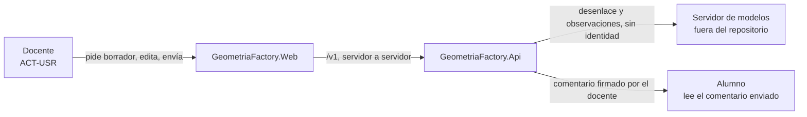
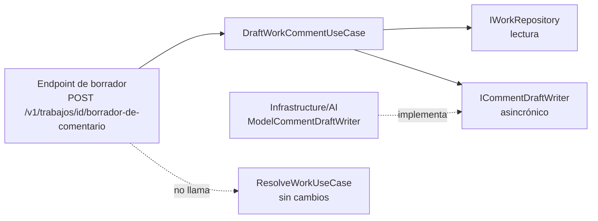

# Capa de IA de la Fábrica de Geometría · V2 · Borrador del comentario del docente

| Campo | Valor |
|---|---|
| Documento | `ai-layer/02-Especificacion-V2-Borrador-De-Comentario.md` |
| Versión | 0.1 (especificación; nada construido) |
| Estado | Propuesta, después del piloto V1 (decisión D-26 c de la mesa: sólo V2 tras V1; V3 y V4 fuera de esta pasada) |
| Fecha | 2026-11-01 |
| Base | `main` `5f07b12` |
| Método | el mismo de V1: Conocimiento de especificación v0 aplicado sin la guía; `[Con §x]` remite a ese conocimiento |
| Reutiliza | de `01-Especificacion-V1-Pistas.md`: ADR-IA-01..03 y 05, la configuración sin valor por omisión, los límites y la telemetría. Aquí se escribe sólo lo que cambia |

## Índice

- [1. Introducción y metas (arc42 §1)](#1-introducción-y-metas-arc42-1)
- [2. Contexto y alcance (arc42 §3)](#2-contexto-y-alcance-arc42-3)
- [3. Vista de bloques (arc42 §5)](#3-vista-de-bloques-arc42-5)
- [4. Conceptos transversales (arc42 §8)](#4-conceptos-transversales-arc42-8)
- [5. Requisitos de calidad (arc42 §10)](#5-requisitos-de-calidad-arc42-10)
- [6. Riesgos (arc42 §11)](#6-riesgos-arc42-11)
- [7. Lo que esta especificación no decide](#7-lo-que-esta-especificación-no-decide)

## 1. Introducción y metas (arc42 §1)

### 1.1 Qué hace hoy el producto

Al resolver un trabajo `Pendiente`, el docente (rol administrador) aprueba o rechaza y puede dejar un
comentario de texto libre, **sin nota ni escala** (capacidad F-21, intake §4; exclusión X-5 retirada, la
calificación sigue excluida). El caso de uso es `ResolveWorkUseCase.ExecuteAsync(…, comment, …)`
(`src/GeometriaFactory.Application/Works/ResolveWorkUseCase.cs`).

**Capacidad V2.** Al abrir la resolución, el docente puede pedir un **borrador** del comentario, armado a
partir de las observaciones del trabajo y del desenlace que eligió. El docente lo edita y lo envía por el
flujo vigente; el modelo no escribe nada.

### 1.2 Las cuatro preguntas [Con §1]

| # | Pregunta | Respuesta |
|---|---|---|
| 1 | ¿Qué hace hoy la persona y por qué un modelo lo mejoraría? | El docente escribe el comentario a mano para cada trabajo; un borrador le ahorra tiempo en los trabajos con varias observaciones |
| 2 | ¿Alcanza una regla? | Para un trabajo sin observaciones, sí: una frase fija. Con observaciones, una plantilla enumera pero no redacta; la plantilla es el respaldo |
| 3 | ¿Qué cuesta un error y quién lo absorbe? | **Error caro:** el borrador incluye una nota o escala (calificación excluida), afirma un error que el validador no encontró o entrega la solución al alumno (el comentario lo lee el alumno: rige `ADR-10010` §2.3 de la Web). Lo absorbe el docente si lo envía sin leer |
| 4 | ¿Con qué métrica y qué umbral? | proporción de borradores que el docente envía con edición menor; 0 borradores con nota, escala o el valor derivado en el banco; umbral de utilidad lo fija el docente (ACT-ARQ) |

### 1.3 Resultado del árbol, escenario, contexto y actores

Árbol [Con §1]: una tarea concreta (redactar) → una regla no alcanza del todo → no es un dato exacto → hay
métrica y error caro → **proponer** (el docente envía). **Nivel A0.**

| Clave | Valor |
|---|---|
| Escenario | **ESC-GEO-02** · redactar un borrador que una persona revisa y firma (código propio, K-01) |
| Contexto | CTX-EXISTENTE · CTX-PROTO · sin CTX-SENS (§2.2) |
| ACT-USR | el docente, que pide, edita y envía |
| ACT-ARQ | el docente, Product Owner |
| ACT-SEC | el Product Owner |

| Capacidad | Escalón de conocimiento | Nivel | Criterio de salto |
|---|---|---|---|
| Borrador de comentario | sólo el pedido: desenlace elegido y observaciones del trabajo (tipo de figura, campo, declarado, sentido) | A0 | ninguno previsto: subir a A1 haría del modelo un actor que resuelve trabajos (ADR-IA-06) |

## 2. Contexto y alcance (arc42 §3)

### 2.1 Contexto (C4 nivel 1)

Figura 2.1. Contexto de V2. La flecha hacia el alumno es la del flujo vigente de desenlace, no del modelo.

### 2.2 Qué sale hacia el modelo

| Viaja | No viaja |
|---|---|
| desenlace elegido (aprobado o rechazado); por observación: tipo de figura, campo, valor declarado, sentido | el JSON del alumno; el valor derivado; nombre, correo o cuenta del alumno; identificador del trabajo; comentarios anteriores |

El trabajo pertenece a una cuenta de alumno, pero nada que la identifique viaja: no hay CTX-SENS.

### 2.3 MCP y clientes

Sin MCP. Cliente único `GeometriaFactory.Web`; las filas de [Con §5] no aplican (igual que V1 §2.4).

## 3. Vista de bloques (arc42 §5)

Figura 3.1. Contenedores de V2. El caso de uso nuevo **sólo lee**; la escritura sigue en
`ResolveWorkUseCase`, que no cambia [Con §2, P-6].

**Ficha de la capacidad [Con §4].**

| Campo | Valor |
|---|---|
| Capacidad | borrador del comentario del docente |
| Contrato | `ICommentDraftWriter` en `Application/Ports/` |
| Firma | `Task<DraftResult> WriteAsync(CommentDraftRequest, CancellationToken)` |
| Adaptador | `ModelCommentDraftWriter` en `Infrastructure/AI/` |
| Caso de uso | `DraftWorkCommentUseCase` en `Application/Works/`: verifica rol administrador y que el trabajo esté `Pendiente` y visible para él, lee las observaciones guardadas |
| Registro | composición de la Api, junto con V1 |
| Regla de ubicación | la de V1 (REQ-IA-01, REQ-IA-02) |
| Doble | `IChatClient` doble con respuestas guionadas, incluidas «Nota: 7/10» y una con el valor derivado |

**Contrato:** tres resultados como V1; *degradado* y *rechazado* devuelven la plantilla («Trabajo
{aprobado|rechazado}. Revisá las observaciones de {campo} en {figura}.»).

**Prompt propio (sistema).**

> Sos un asistente de un docente de programación. Redactá un borrador breve del comentario que el docente
> le deja al alumno al {aprobar|rechazar} su trabajo. Reglas: 1) no pongas nota, puntaje ni escala; 2) no
> escribas el valor correcto, JSON, código ni nombres de clases; 3) mencioná sólo las observaciones que te
> paso, sin inventar otras; 4) tono respetuoso, en segunda persona, a lo sumo cuatro oraciones.

## 4. Conceptos transversales (arc42 §8)

- **Filtro posterior:** el de V1 (valor derivado, JSON, código) más dos reglas: rechaza una nota o escala
  (número seguido de `/10`, `puntos`, `nota`, o las palabras «calificación», «puntaje») y rechaza un
  campo o figura que no esté entre las observaciones del pedido.
- **Aprobación:** no hay aprobación de una escritura del modelo, porque el modelo no escribe. El docente
  envía su texto por `ResolveWorkUseCase`; el borrador no se guarda.
- **Autorización:** la del endpoint vigente de desenlace (rol administrador sobre trabajos que ve, RN-02010).
- **Datos, servidor, telemetría, límites:** los de V1 §4.3 a §4.5; hasta 10 observaciones por borrador.

## 5. Requisitos de calidad (arc42 §10)

Se suman a REQ-IA-01..03, 11 y 15 de V1, que valen igual.

| Id | Requisito | PROTO | PROD | Criterio de aceptación | Prueba | Tipo |
|---|---|---|---|---|---|---|
| REQ-IA-20 | Al modelo no viajan identidad, JSON ni valor derivado | DEBE | DEBE | el doble captura mensajes sin nombre, correo, id de cuenta o de trabajo, texto original ni derivado | `DraftRequest_CarriesNoIdentityNorSolution` | garantía |
| REQ-IA-21 | El caso de uso del borrador no escribe | DEBE | DEBE | después de pedir el borrador el trabajo sigue `Pendiente` y sin comentario | `Draft_DoesNotChangeWork` | garantía |
| REQ-IA-22 | Sólo el administrador que ve el trabajo pide su borrador | DEBE | DEBE | un alumno recibe el rechazo de rol; un trabajo no visible da no encontrado | `Draft_RequiresAdministratorWhoSeesTheWork` | garantía |
| REQ-IA-23 | El filtro rechaza nota o escala | DEBE | DEBE | «7/10», «8 puntos», «nota 6», «calificación» se rechazan | `DraftFilter_RejectsGrades` | garantía |
| REQ-IA-24 | El filtro rechaza observaciones inventadas | DEBE | DEBE | un borrador que nombra `Volumen` cuando sólo hay observaciones de `Area` se rechaza | `DraftFilter_RejectsUnlistedObservations` | garantía |
| REQ-IA-25 | Sin modelo o con rechazo, plantilla | DEBE | DEBE | cada falla del doble devuelve la plantilla con origen `plantilla` | `Draft_FallsBackToTemplate` | garantía |
| REQ-IA-26 | El borrador ahorra trabajo | DEBERÍA | DEBE | proporción de borradores enviados con edición menor ≥ el umbral que fije el docente, como k de n | revisión docente rotulada | conducta |
| REQ-IA-27 | Sin nota ni solución en el banco | DEBE | DEBE | 0 borradores aceptados por el filtro con nota, escala o valor derivado en un banco de 30–50 trabajos sintéticos | corrida rotulada del banco de V2 (por construir) | conducta |

## 6. Riesgos (arc42 §11)

| Riesgo | ¿Se activa en A0? | Control | Requisito |
|---|---|---|---|
| LLM01:2025 Prompt Injection | sí, sin superficie: el pedido se arma con constantes y números | lista permitida; el JSON no viaja | REQ-IA-20 |
| LLM02:2025 Sensitive Information Disclosure | no: nada identifica al alumno | — | REQ-IA-20 |
| LLM05:2025 Improper Output Handling | sí | filtro con nota, escala y observaciones inventadas | REQ-IA-23, REQ-IA-24 |
| LLM10:2025 Unbounded Consumption | sí | límites de V1 | REQ-IA-10 de V1 |
| LLM09:2025 Misinformation (fuera del v0) | sí | sólo observaciones del pedido; el docente firma | REQ-IA-24, REQ-IA-26 |
| ASI09 Human-Agent Trust Exploitation | **según el v0, no** (se activa desde A1 con aprobación). Pero el riesgo existe en A0: el docente puede enviar el borrador sin leerlo (hallazgo K-06) | el borrador llega al campo editable marcado como borrador y nunca se envía solo | REQ-IA-21 |

## 7. Lo que esta especificación no decide

- El umbral de REQ-IA-26 (lo fija el docente).
- El banco de V2: trabajos sintéticos con observaciones conocidas; no se construyó en esta pasada.
- Si el borrador debe además evitar el valor derivado: el comentario lo lee el alumno, por eso esta
  especificación lo prohíbe; el docente puede escribirlo él mismo si lo decide. Se eleva para confirmar.
